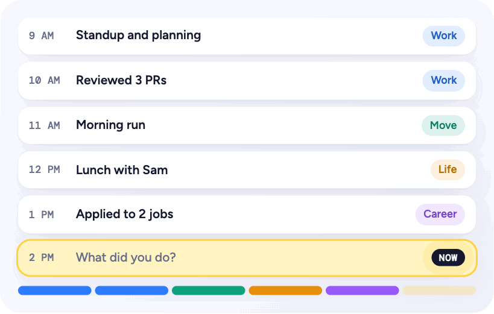
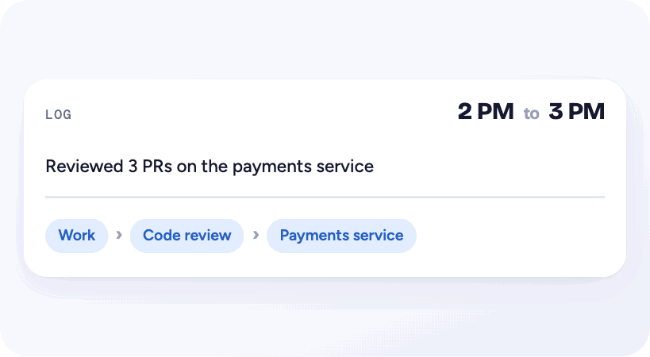
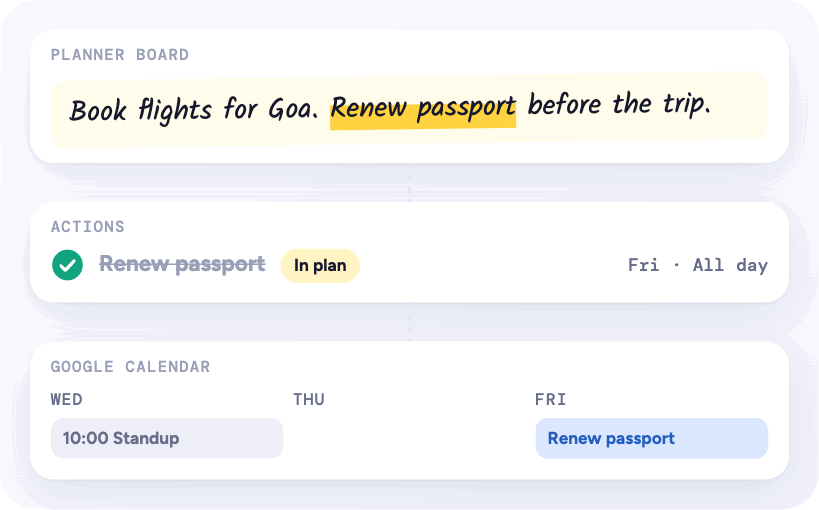
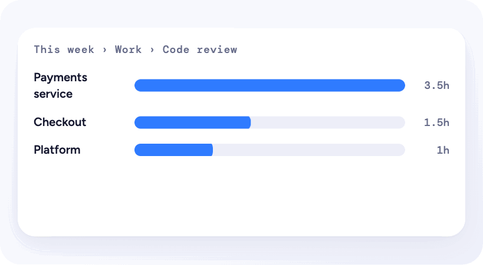
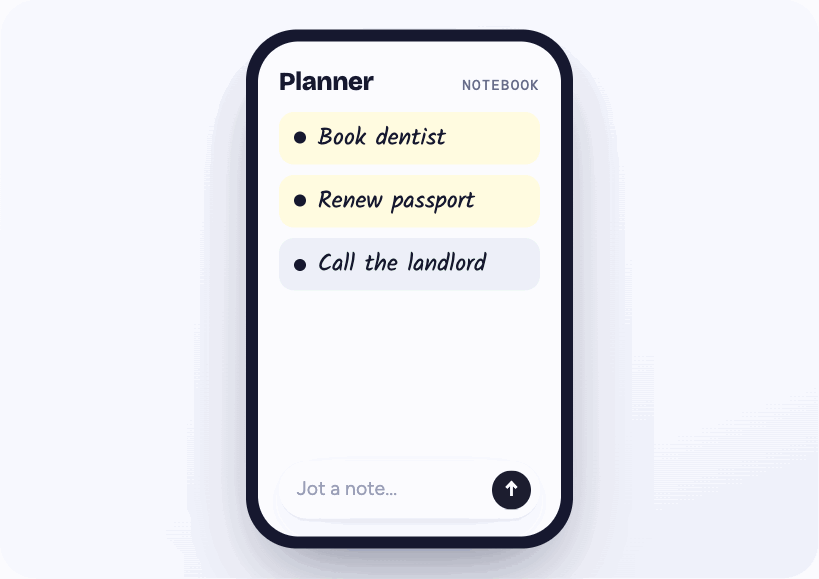

# Hour by Hour

**A tiny journal for your hours.** Live at **[hour-by-hour.xyz](https://hour-by-hour.xyz)**, or [try the demo](https://hour-by-hour.xyz/demo) without signing in.

<p align="center"></p>

## Why this exists

Most time trackers ask you to start a timer before you do something, or to pick a project and a category after. Both are friction, so people stop using them within a week, and the record ends up being of the hours that were easy to label rather than the hours that actually happened.

Hour by Hour starts from a different bet: **the cheapest possible input, with structure added afterwards.** You write what you did in plain words, one short or long pointer at a time ("reviewed 3 PRs on the payments service", "5k along the river"). An AI files each pointer into a tag tree that grows with you, so a week can be read broadly (Work, Health, Career) or deeply (Work › Code review › Payments service), without you ever choosing a category.

The rest of the app closes the loop between planning and doing:

- **A planner board.** A whiteboard for loose plans. Select a phrase on a note and turn it into an action.
- **Actions.** To-dos with an optional date and time, or all day. They can come from the board, from your log ("Generate actions"), or be typed in directly, and they can sync to Google Calendar.
- **Log-to-action links.** When a pointer is about an open action, it gets linked, so an action shows the hours you spent on it and you can mark it done from the log.
- **Insights.** Hours per tag over a day or week, drillable from the root down.

The goal is an honest record of where time goes, built from input that takes about five seconds an hour.

## A quick tour

**Log an hour in five seconds.** Type what you did. The AI files it into your tag tree.

<p align="center"></p>

**From a whiteboard thought to your calendar.** Select a phrase on the board, make it an action, and it lands on Google Calendar.

<p align="center"></p>

**Zoom from the week to the detail.** Tags nest, so insights drill from Work to Code review to one service.

<p align="center"></p>

**Made for your phone too.** On a small screen the board becomes a notebook.

<p align="center"></p>

These are recordings of the animated scenes on the landing page, not screenshots of real data.

## Status

This is a personal project in active use, not a product. The Google OAuth app is in production but not yet verified, so connecting Google Calendar shows Google's "unverified app" screen and the app is capped at 100 users. Push notifications were removed on purpose until there is a native mobile app. There are no automated tests yet.

## Stack

| Layer | Choice |
| --- | --- |
| App | Next.js 16 (App Router, `proxy.ts`), React 19, TypeScript, hand-written CSS |
| Data and auth | Supabase: Postgres with row-level security on every table, Google sign-in, Realtime |
| AI | Google Gemini over REST (`gemini-2.5-flash` by default), with keyword fallbacks |
| Calendar | Google Calendar API with a separate, opt-in OAuth grant |
| Hosting | Vercel (production deploys from `main` only), Vercel Analytics and Speed Insights |

No UI kit and no AI SDK. Both were deliberate, to keep the bundle small and the moving parts visible.

## How it works

- **Data model.** One row per user per hour in `hour_logs`, holding an `items` JSON array of pointers (`{ id, text, tags[], actions?[] }`). Tags are a self-referencing tree in `tags` (`parent_id`). Actions live in `reminders` (the table kept its original name). The planner board is a single JSON document per user in `plans`. See [`supabase/migrations`](supabase/migrations).
- **Security boundary.** The browser talks to Supabase directly using the publishable key, and every table is protected by RLS scoped to `auth.uid()`. Server routes in `app/api` use the user's session, not the secret key, wherever they can. `google_connections` has no client grants at all and is only touched server-side.
- **AI tagging** (`app/api/tag`). The user's current tag tree and open actions go to Gemini with a JSON response schema. The model reuses existing tags where they fit and creates new ones only when needed. Returned paths are created idempotently. If Gemini is not configured or fails, a keyword heuristic tags instead, and the UI says "Basic tagging".
- **Writes are offline-tolerant.** Edits go to a local outbox in `localStorage` and are flushed with a debounce, so typing never waits on the network. Realtime keeps other devices in sync.
- **Google Calendar.** Refresh tokens are encrypted with AES-256-GCM (`lib/crypto.ts`) before they are stored. Events the app creates are tagged with a private extended property, and the app only edits or deletes its own events. A dated action without a time becomes an all-day event.
- **Demo mode.** `/demo` runs the same client with seeded local data, no account, no server writes, and rule-based AI stand-ins.

## Project layout

```
app/                 routes, API handlers, metadata images, legal pages
  api/tag            AI tagging and log-to-action linking
  api/actions        "Generate actions" from a log or from the planner board
  api/gcal, api/google  Calendar sync and the OAuth connect/callback/disconnect flow
components/          client UI (HourApp is the main shell)
lib/                 tags, plan, reminders, Gemini, Google, crypto, Supabase clients
supabase/migrations  the full schema history, applied in order
docs/media           README recordings of the landing page scenes
```

## Running it locally

You need Node 20+, a Supabase project, and optionally a Gemini API key and a Google Cloud OAuth client.

```bash
npm install
cp .env.example .env.local   # then fill in the values
npx supabase link --project-ref <your-project-ref>
npx supabase db push         # applies supabase/migrations
npm run dev
```

In Supabase, enable the Google auth provider and add `http://localhost:3000/auth/callback` to the redirect URLs. Without `GEMINI_API_KEY` the app still works, with keyword-based tagging. Without the Google Calendar variables, connecting Calendar returns you to the app with a "not configured" notice.

### Environment variables

| Variable | Required | Purpose |
| --- | --- | --- |
| `NEXT_PUBLIC_SUPABASE_URL` | yes | Supabase project URL |
| `NEXT_PUBLIC_SUPABASE_PUBLISHABLE_KEY` | yes | Supabase publishable key (safe in the browser, RLS enforces access) |
| `SUPABASE_SECRET_KEY` | for Calendar | Server-only key, used to read and write `google_connections` |
| `GEMINI_API_KEY` | no | Enables AI tagging and action suggestions |
| `GEMINI_MODEL` | no | Overrides the default model |
| `GOOGLE_CLIENT_ID`, `GOOGLE_CLIENT_SECRET` | for Calendar | OAuth client for the Calendar grant. Redirect URI is `<origin>/api/google/callback` |
| `GOOGLE_TOKEN_KEY` | for Calendar | 32 random bytes, base64 (`openssl rand -base64 32`), used to encrypt refresh tokens |

## Database changes

Every schema change goes through a migration file in `supabase/migrations` and is applied with `supabase db push`. Production data and schema are never edited by hand.

## Privacy

Your entries are visible only to you. Pointer text is sent to the Gemini API to produce tags and suggestions. Full details are in the [privacy policy](https://hour-by-hour.xyz/privacy) and [terms](https://hour-by-hour.xyz/terms).

## Contact

banerjeec713@gmail.com
